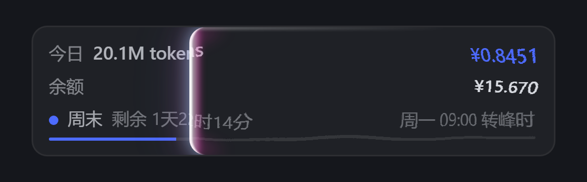

# dsh-usage-hud

DSH（DeepSeek Harness）用量看板插件：在侧栏底部显示**今日 tokens / 今日花费 / 账户余额 / 峰谷倒计时**，在右下角浮动显示**本会话累计消耗估算**。在侧栏那块上点右键会播放一道「玻璃片抽离」特效，并同时刷新两者的数据。

> 全部数据本地读取：会话日志来自 `~/.dsh/sessions/`，余额来自 DeepSeek 官方 `/user/balance` 接口。插件不上传任何数据。



## 功能

| 位置 | 内容 |
|---|---|
| 侧栏底部（slot `sidebar.footer.action`） | 今日 tokens、今日花费（¥）、余额（¥）、当前峰/谷、距下次切换的倒计时、进度条 |
| 右下角浮动卡（slot `shell.overlay`） | 本会话累计消耗估算（按每条消息发生时的峰谷价折算），不可点击，不遮挡鼠标 |
| 右键侧栏那块 | 刷新两边数据 + 播放玻璃片抽离特效 |

自动轮询只更新数字、不播动画：侧栏 20 秒一次，会话卡 15 秒一次。

## 安装

> 注意：这个包**不发布到 npm**，所以 `dsh plugin add dsh-usage-hud` 会失败（会去 registry 找一个不存在的包）。用下面两种方式之一安装。

### 方式一：从 GitHub 安装（推荐）

```powershell
dsh plugin --profile desktop add github:Shane-QS/dsh-usage-hud          # 跟 main 最新
dsh plugin --profile desktop add github:Shane-QS/dsh-usage-hud#v1.0.0   # 锁定版本
```

### 方式二：手动放进 profile

1. 把整个仓库复制到 profile 的 `node_modules` 下：

```cmd
xcopy /E /I dsh-usage-hud "%USERPROFILE%\.dsh\profiles\desktop\node_modules\dsh-usage-hud"
```

2. 打开 `%USERPROFILE%\.dsh\profiles\desktop\package.json`，加两处：

```jsonc
{
  "dependencies": {
    "dsh-usage-hud": "file:./node_modules/dsh-usage-hud"
  },
  "dsh": {
    "bundles": ["@deepseek-ai/dsh-base", "@deepseek-ai/dsh-web-app", "dsh-usage-hud"]
  }
}
```

3. **重启 DSH**。

客户端代码是在宿主启动时组装进 bundle 的，热改不生效——改 `client.js` 之后也必须重启。

## 配置

配置文件：`~/.dsh/usage-hud.json`（支持 `//` 整行注释和尾逗号；改完 20 秒内生效，或在侧栏右键立即生效）

```jsonc
{
  "wave": "pull",          // "pull" = 玻璃片抽离（默认）；"A" / "B" / "C" = 旧版白光三种款式
  "cardBottom": 67,        // 右下角会话卡距窗口底部 px（越大越往上）
  "cardRight": 18,         // 距窗口右侧 px

  "prices": {              // 元 / 百万 tokens；不写则用内置默认价目表
    "deepseek-flash": {
      "peak": { "cache_hit": 0.04, "cache_miss": 2, "output": 8 },
      "idle": { "cache_hit": 0.02, "cache_miss": 1, "output": 4 }
    }
  },

  "peakWindows": [["09:00", "12:00"], ["14:00", "18:00"]],  // 北京时间，周一至周五
  "holidays": { "2026": ["2026-01-01", "2026-02-16"] },     // 法定节假日，全天按峰谷价

  "defaultModel": "deepseek-flash",  // 认不出模型名时按谁计价
  "balanceTtlMs": 60000,             // 余额缓存时长
  "balanceTimeoutMs": 12000          // 余额请求超时
}
```

## 计价与口径

- **今日**：按北京时间自然日切分，汇总当天所有根会话（含子代理会话）的 usage
- **本会话**：当前窗口正在看的那个会话（客户端跟随主视图保留的会话，切换会话/窗口立即换口径）；拿不到当前会话时才退回「最近被写的根会话」。**文件夹大小逻辑**：主会话把 `parentSession` 指向它的全部子代理/孙代理一起算进来（卡片显示合计 + 「含 N 个子会话」徽标，悬停可见本会话与子会话各自多少）；点进某个子代理会话时，显示它自己那一支的合计
- **估算**：`inputTokens` 按「缓存未命中」计价，`cacheReadTokens` 按「缓存命中」计价，`outputTokens` 按输出计价；每条消息按它发生时刻的峰谷价折算后累加
- 峰谷：周一至周五 `09:00–12:00`、`14:00–18:00` 为高峰价；周末与 `holidays` 中的日期全天峰谷价

## 已知限制

- 仅验证过 **DSH Desktop**；`sidebar.footer.action` / `shell.overlay` 两个 slot 在 Web 版是否可用未测试
- 会话数据来自 `session.v4.jsonl.zstd`，DSH 若更换会话存储格式需要同步修改 `lib/index.js`
- 正在生成的那一轮消息还没落盘，所以数字可能比实时少一轮
- 修改 `client.js` 后必须重启 DSH

## 目录结构

```
dsh-usage-hud/
├── package.json         # 插件清单（dsh.bundle.patch + dsh.client）
├── cordis.patch.yml     # 宿主注入点声明
├── lib/index.js         # 宿主半边：/usage-hud/api/state、/usage-hud/api/session、余额、峰谷
├── client.js            # 客户端半边：侧栏块、会话卡、玻璃片抽离特效
├── README.md
├── LICENSE
└── docs/
    ├── screenshot.png   # README 里引用的效果图
    └── demo.html        # 特效演示页，浏览器直接打开即可看玻璃片扫动
```

## License

MIT
